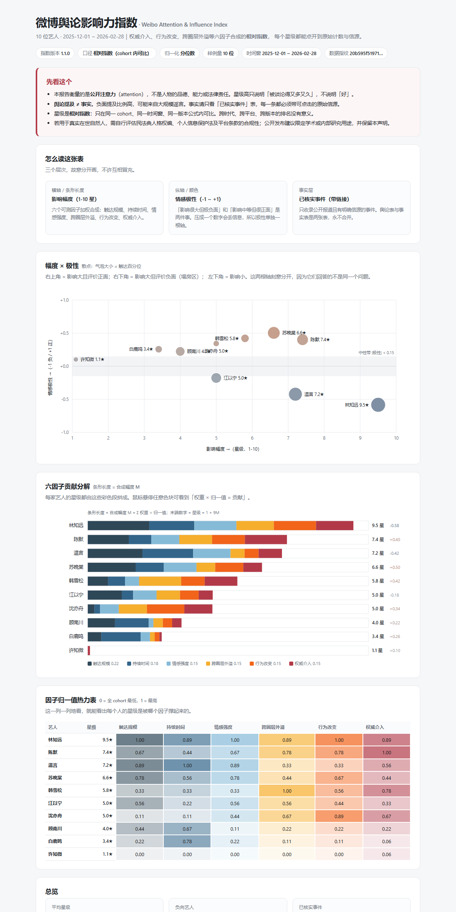

# 微博舆论影响力指数 · Weibo Attention & Influence Index

[](https://github.com/OWNER/weibo-influence-index/actions/workflows/ci.yml)
[](pyproject.toml)
[](LICENSE)
[](pyproject.toml)

**一个可复算、可解释、口径公开的"1-10 星"相对指数。**

它回答的问题不是"这个艺人怎么样"，而是：

> 在一个给定的时间窗内，**谁占据了多少公开注意力？注意力持续了多久？烧到了娱乐版之外的哪些版面？有没有留下可观测的行为改变和权威动作？**

它明确不回答"这个人是好人还是坏人"。星级只标在**影响幅度**轴上，情感极性（正 / 负）单独一根轴、单独一套颜色，两者永不合并——因为"影响很大但极负面"（塌房）和"影响中等但很正面"（公益出圈）压成一个数字就是丢信息。



> 上图由 `data/demo` 里的**全合成数据**生成（人物、事件、信源均为虚构），仓库不含任何真实自然人数据。

---

## 为什么能做，以及为什么这样做

给在世自然人打一个带负面倾向的公开评分，最常见的死法不是技术失败，而是**不可复算**：拍一个星级，答不出"为什么是 7 星不是 6 星"。本项目的全部设计都围绕一条底线：

**口径公开、公式可复算、每一颗星都能拆到原始计数和原始信源。**

为此做了四个决定：

1. **一维星级拆成两维。** 横轴幅度（1-10 星），纵轴极性（-1 ~ +1）。星级只标在幅度轴上。
2. **幅度拆成六个可测因子**（见下表），每个因子先算"原始量"，再做跨 cohort 归一化，再加权合成。权重是参数，全部写在 `config.py` 里，改了必须升版本号。
3. **"已证实事件"与"舆论提及"是两张表，永不合并。** 一个人可以被造谣到负面比例 90%，这不构成任何事实陈述。事实表里每一条都必须挂原始链接，没有信源的内容进不了表。
4. **校验层独立存在。** 合成数据里埋了一个评分器看不见的"潜在真值"，`wii validate` 检查指数能否还原它；另有一组用常识写的断言（塌房者极性必须为负、央媒发声者权威百分位必须进前 20%……）。**任何一项失败，回去调权重，绝不改期望值。**

## 快速开始

```bash
git clone https://github.com/OWNER/weibo-influence-index.git
cd weibo-influence-index
pip install -e .            # 零第三方依赖，纯标准库

wii demo                    # 生成确定性合成数据 → data/demo
wii build                   # 算指数 + 生成 build/report.html（单文件，无外部请求）
wii validate                # 回测 + 常识断言 + 权重稳定性，失败时退出码 1
wii explain --artist a01    # 打印某人星级的完整算法拆解
wii sensitivity             # 权重 ±5% 扰动下的排名与星级稳定性

# 真实数据没有现成情感分？用内置词典基线从文本打分
wii sentiment --data data/demo --out build/mentions.scored.jsonl --compare
wii build --data data/demo --sentiment lexicon   # 不信任文件里的 sentiment 时
```

打开 `build/report.html` 即可。任何一条命令都不联网；接大模型抽取时才需要 `WII_LLM_API_KEY`。

### 文档

| 文档 | 什么时候读 |
|---|---|
| [METHODOLOGY.md](METHODOLOGY.md) | 想复算星级、想知道每个因子怎么来的、想看已知缺陷 |
| [ETHICS.md](ETHICS.md) | **跑真实数据之前**。法律风险、准入清单、更正/删除流程、我们明确不做的事 |
| [CONTRIBUTING.md](CONTRIBUTING.md) | 想提 PR。改因子要过哪五关、代码风格、提交规范 |
| [CHANGELOG.md](CHANGELOG.md) | 想知道 v1.1.0 到底做了哪些取舍 |
| [PUBLISHING.md](PUBLISHING.md) | 想 fork 一份发自己的 GitHub / Pages |
| [CITATION.cff](CITATION.cff) | 要引用它 |

在 demo 数据上，校验层的输出（可自行复现）：

```
PASS  (12/12 项通过)
  [✓] rank_recovery.spearman:  Spearman ρ = 0.960（阈值 ≥ 0.80，n = 10）
  [✓] rank_recovery.kendall:   Kendall τ = 0.909（阈值 ≥ 0.60）
  [✓] rank_recovery.top3:      Top-3 重合 2/3（要求 ≥ 2）
  [✓] rule:塌房顶流应≥7.5 星          实测 9.5
  [✓] rule:塌房顶流极性应为明显负值     实测 -0.58
  [✓] rule:央媒集体发声者权威百分位≥0.8  实测 1.00
  [✓] stability.rank_shift:    单因子权重 ±5% 最大位移 1 名（阈值 ≤ 2）
  [✓] stability.stars_shift:   单因子权重 ±5% 最大位移 0.30 ★（阈值 ≤ 0.6）
  ...
```

## 六个因子

| 因子 | 权重 | 回答的问题 | 输入 | 怎么算 |
|---|---|---|---|---|
| 触达规模 | 0.22 | 有多少人可能看到了？ | 话题阅读量、讨论量、热搜条数、跨平台覆盖数 | 对数缩放 + 平台广度，加权合成 |
| 持续时间 | 0.18 | 烧了多久才凉？ | 每日提及量曲线 | 有效发酵天数（≥ 峰值 25%）+ 衰减半衰期（对数线性拟合） |
| 情感强度 | 0.15 | 情绪有多浓？ | 逐条情感分（`wii sentiment` 可从文本生成） | **绝对值**加权均值，正负都算强度 |
| 跨圈层外溢 | 0.15 | 出娱乐版了吗？ | 提及的垂类分布 + 已核实事件的垂类 | 按垂类距离加权求和 |
| 行为改变 | 0.15 | 有人因此改变行为吗？ | 代言增减、票房/销量、项目取消、机构回应 | 只从**已核实事件**计数，封顶 |
| 权威介入 | 0.15 | 官方下场了吗？ | 央媒、地方官媒、行业协会、监管 | 分层加权计数，封顶 |

完整公式、归一化方法、封顶与已知缺陷见 **[METHODOLOGY.md](METHODOLOGY.md)**。一句话版本：

```
M     = Σ  w_i · n_i          n_i ∈ [0,1]（cohort 内归一化）
stars = 1 + 9 · M             显示保留 1 位小数
valence = Σ weight · s / Σ weight    单独报告，不进星级
```

### 极性与它的区间

`valence` 还带一个 95% 自助法区间：重抽样单位是单条提及，随机种子由 `artist_id` 派生，所以同一份数据永远得到同一个区间，截图可以被复核。样本少于 30 条时不给区间——样本小的时候，区间只会假装精确。**触达没有区间**：平台阅读量是计数不是抽样，给它配区间是假精度。

没有现成情感分时，`wii sentiment` 会用内置词典基线（否定、程度副词、反讽规则）直接从文本打分。它是一份可审计的对照物，不是"更好的模型"：跑 `--compare` 会输出与文件里原有打分的 MAE、同号率，谁更接近真相要你自己用标注集判断。

## 这个指数不是什么

诚实清单，每一条都在报告页脚再印一遍：

- **不是影响力**，是**注意力**。热度高可能只是被骂得惨；真正深远的影响（推动行业规范）热度往往不高。命名上它是 attention index，不是 impact index。
- **不是民意调查。** 中文反讽（"呵呵""真有你的"）会让词典法情感分析系统性出错；控评和水军只能靠账号加权缓解。极性数字应读作"语调分布"。
- **极性区间不是准确率。** 它只回答"换一批帖子，这个均值会飘多少"，不回答"打分对不对"。后者只能靠标注集（`wii audit-*` 与 `wii sentiment --compare`）。
- **不是事实认定。** 事实只看 `events_verified.jsonl`，且每条必须有信源。
- **跨年代不可比。** 2010 年前没有可比的社交媒体计数。同一 cohort、同一窗口内才可比。
- **分位数归一化下，cohort 里必然有人落在 1 星**。那表示"在这批人里最低"，不是"不值一提"。

## 合规与伦理（先读这个再跑真实数据）

见 **[ETHICS.md](ETHICS.md)**。要点：只收录公开报道且有明确信源的事件；不做人格评价；触达真实自然人时自行评估民法典人格权编、个人信息保护法与平台条款；公开发布建议限定学术或内部研究用途并保留免责声明；演示一律用合成人物。

**本仓库刻意不带爬虫。** 采集层只提供两种可审计的导入格式（供应商 CSV / 你自己采集器的 JSONL 桥接格式），见 `src/wii/ingest/importers.py` 的模块注释——原因也写在那里。

## 项目结构

```
src/wii/
├── config.py            # 因子定义、权重、封顶——所有影响星级的数字都在这一个文件
├── schema.py            # 四张表；已证实事件与舆论提及严格分离
├── store.py             # 加载/写出/数据指纹（SHA-256，报告会印）
├── ingest/
│   ├── importers.py     # 供应商 CSV 与桥接 JSONL 导入（不带爬虫）
│   ├── weights.py       # 账号加权：控评/水军的最低成本防御
│   └── fixtures.py      # 确定性合成数据生成器（含潜在真值）
├── extract/
│   ├── llm.py           # 事件抽取 prompt（OpenAI 兼容接口，可 dry-run）
│   ├── normalizer.py    # 日期归一化 / 同日去重 / 排序 / 无信源硬门槛
│   └── audit.py         # 人工抽检准确率（抽样 → 标注 → Wilson 区间）
├── score/
│   ├── factors.py       # 六因子的原始量 + 诊断信息
│   ├── normalize.py     # 分位数 / Z 分数→正态 CDF
│   ├── stats.py         # 加权均值/标准差、分位数、自助法区间（无 numpy）
│   ├── index.py         # 加权合成 → 星级；极性单独一路
│   └── explain.py       # "为什么是 7 星不是 6 星"的算术拆解
├── sentiment/
│   ├── lexicon.py       # 可审计词典：极性词、否定、程度副词、反讽标记
│   └── scorer.py        # 文本 → 极性 + 命中词 + 置信度（启发式，不是概率）
├── validate/backtest.py # Spearman/Kendall、Top-K、常识断言、权重稳定性
└── report/
    ├── svg.py           # 手写 SVG 图表（无 JS、无 CDN、离线可开）
    └── build.py         # 自包含 HTML 报告
tests/                   # 84 个用例，全部离线
```

## 路线图

- [x] 情感打分内置词典法 + 反讽规则基线（`wii sentiment`，含否定/程度副词）
- [x] 权重敏感性自动化进 `wii validate`（名次位移 + 星级位移两项）
- [x] 置信区间：对极性做自助法（bootstrap）；触达是平台口径计数，不做假区间
- [x] GitHub Pages 自动发布 demo 报告（`.github/workflows/pages.yml`）
- [ ] 多窗口滚动对比（同口径、不同窗口，明确标注不可跨窗排名）
- [ ] 极性打分接微调模型，并把词典基线的 MAE 作为回归门槛

## 引用

```bibtex
@software{weibo_influence_index_2026,
  title  = {Weibo Attention \& Influence Index},
  year   = {2026},
  url    = {https://github.com/OWNER/weibo-influence-index},
  note   = {A reproducible public-attention index; magnitude and sentiment polarity are reported on separate axes.}
}
```

## 许可

MIT，附一条伦理使用提示（见 LICENSE 文末）。指数衡量公开注意力，不构成对任何自然人的评价。

---

### English summary

A reproducible, fully auditable 1–10 star **relative** index of public *attention* on Weibo. Stars live on a magnitude axis built from six measurable factors (reach, duration, emotional intensity, cross-circle spillover, behaviour change, authority intervention); sentiment polarity is reported on a separate axis and never folded into the score. "Verified events" (each with a mandatory source URL) and "opinion mentions" are two different tables that are never merged. Polarity carries a seeded bootstrap 95% interval (posts are the resampling unit; reach deliberately has none, because read counts are counters, not samples). An offline lexicon scorer with negation, degree and irony rules (`wii sentiment`) covers the case where your export has text but no sentiment labels. The synthetic demo cohort embeds a latent ground truth the scorer cannot see, and `wii validate` checks rank recovery (Spearman ρ ≥ 0.80), six common-sense archetype assertions, and weight stability under ±5% perturbations. Zero third-party dependencies; the report is a single self-contained HTML file with hand-rolled SVG charts. **The repository deliberately ships no crawler** — collection is expected to come from licensed vendors or your own compliant collector, via two documented import formats. See [METHODOLOGY.md](METHODOLOGY.md) and [ETHICS.md](ETHICS.md).
